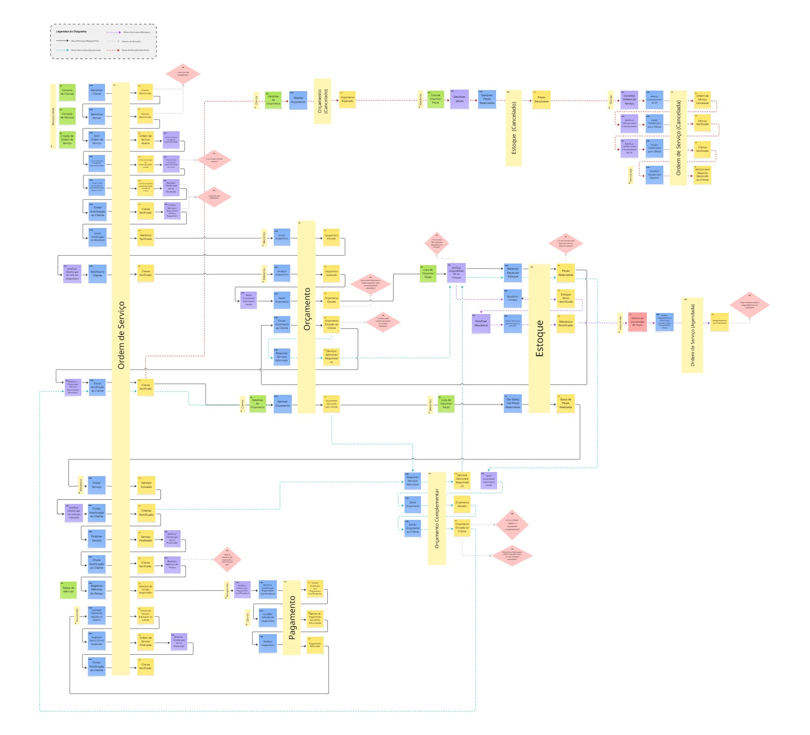
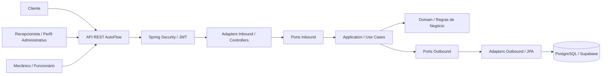
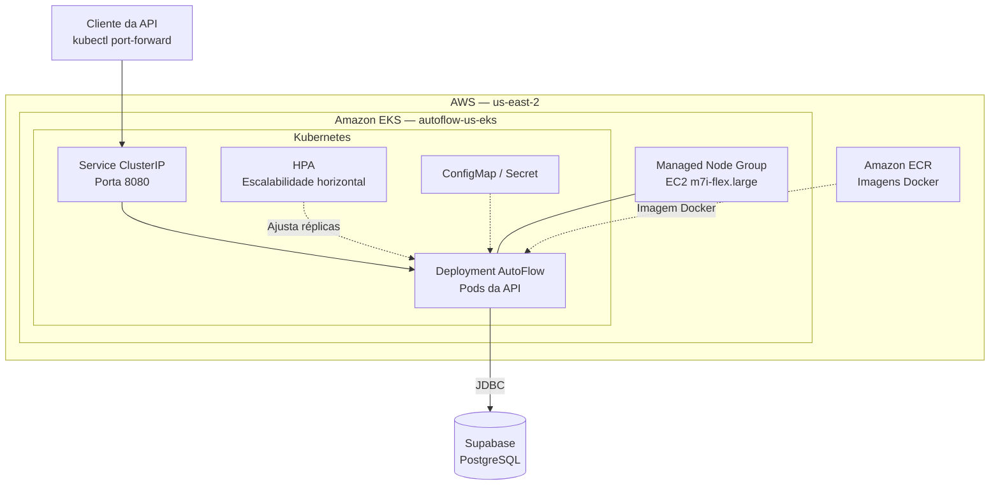
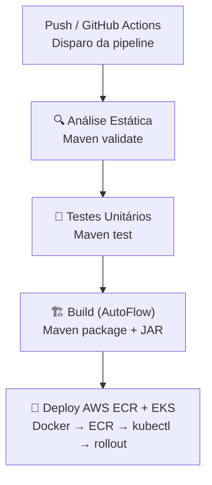

# AutoFlow


_Sistema para gerenciamento dos processos de oficinas mecânicas, centralizando o ciclo de vida das Ordens de Serviço (OS), desde a abertura até a entrega do veículo._

---

## 👥 Equipe e Materiais

### Participantes

| Participante | Discord |
| --- | --- |
| Thalita de Alencar | Thalita. (`thalita_`) |
| Bruna Zorzanello | Bruna Zorzanello (`brunazorzanello`) |
| Caroline Lampert | Carolsla (`carolsla`) |

### Materiais do Projeto

- **Documentação DDD:** [Board no Miro](https://miro.com/app/board/uXjVH7ifFEw=/?share_link_id=371619344967)
    - **Storytelling:** [Storytelling](./docs/assets/storytelling.jpg)
- **Pitch do MVP:**  
    - [Fase 1](https://www.youtube.com/watch?v=LDuQph48AqU)  
    - [Fase 2](https://www.youtube.com/watch?v=DECSsjB2b_E)

---

## 🗄️ Seções do Documento

| Seção                                             | Subseções                                                                                |
| ------------------------------------------------- | ---------------------------------------------------------------------------------------- |
| [🎯 Visão Geral](#-visão-geral)                   | [Objetivo](#objetivo-do-sistema), [Stack](#stack-tecnológica), [Fluxo](#fluxo-principal),  [DDD](#domain-driven-design)|
| [🏗️ Arquitetura](#️-arquitetura) | [Estrutura](#estrutura-da-solução), [HLD](#diagrama-de-alto-nível-high-level-designhld), [Infraestrutura](#infraestrutura-provisionada), [Diagrama da Infraestrutura](#diagrama-da-infraestrutura), [Fluxo de Deploy](#fluxo-de-deploy) |
| [💼 Regras de Negócio](#-regras-de-negócio)       | [Principais Regras Implementadas](#principais-regras-implementadas)                                            |
| [📚 Documentação Oficial](#-documentação-oficial) | [Negócio](#negócio), [Técnica](#técnica), [Arquitetura](#arquitetura-1)                  |
| [⚙️ Execução](#-execução)                         | [Pré-requisitos](#pré-requisitos), [Inciando o Projeto](#terminal-ou-ide) [Docker](#docker), [SonarQube](#sonarqube), [Terraform](#provisionamento-com-terraform), [Kubernetes](#deploy-no-kubernetes), [Swagger](#swagger-ui)        |
| [✅ Observações](#-observações)                   | [Importantes](#observações-importantes), [Custos e Desprovisionamento](#custos-e-desprovisionamento)               |

---

## 🎯 Visão Geral

### Objetivo do Sistema

O AutoFlow foi desenvolvido para substituir processos manuais e descentralizados por um fluxo centralizado de atendimento e execução de serviços em oficinas mecânicas. 

Ele tem como propósito:

- **Centralizar** o ciclo de vida da Ordem de Serviço;
- **Controlar** o fluxo entre recebimento, diagnóstico, aprovação, execução e entrega;
- **Apoiar** a gestão de estoque, orçamento, pagamento e histórico operacional;
- **Disponibilizar** métricas para acompanhamento das atividades da oficina.

### Stack Tecnológica

| Área | Tecnologias |
| --- | --- |
| Back-end | Java 25, Spring Boot 4.1.0, Spring Web MVC |
| Persistência | Spring Data JPA, Hibernate, PostgreSQL (Supabase) |
| Segurança | Spring Security, JWT |
| API | REST, Springdoc OpenAPI, Swagger UI |
| Mapeamento e produtividade | MapStruct, Lombok, Maven Wrapper |
| Qualidade | JUnit, JaCoCo, SonarQube |
| Containers e orquestração | Docker, Docker Compose, Kubernetes, HPA |
| Nuvem e infraestrutura | AWS ECR, AWS EKS, EC2, Terraform |
| CI/CD | GitHub Actions |

### Fluxo Principal

```text
RECEBIDA
  ↓
EM_DIAGNOSTICO
  ↓
AGUARDANDO_APROVACAO
  ↓
ORCAMENTO_APROVADO
  ↓
EM_EXECUCAO
  ↓
FINALIZADA
  ↓
ENTREGUE
```

### Domain Driven Design
A descoberta e modelagem do domínio foram realizadas utilizando práticas de DDD, incluindo:

- **Brainstorming;**
- **Domain Storytelling;**
- **Eventos Pivotais;**
- **Linha do Tempo;**
- **Event Storming.**

Os diagramas e o detalhamento da descoberta do domínio estão concentrados na [Documentação de Negócio](./docs/BUSINESS.md).

<p>
  
</p>

---

## 🏗️ Arquitetura

### Estrutura da Solução

O sistema segue uma arquitetura monolítica modular em Spring Boot, adotando a **arquitetura hexagonal (Ports and Adapters)** e separando o núcleo do negócio dos mecanismos de entrada e persistência. 

| Componente | Responsabilidade |
| --- | --- |
| `adapters/inbound` | Controllers REST e adaptação das requisições HTTP |
| `ports/inbound` | Contratos de entrada para casos de uso |
| `application/usecase` | Coordenação dos casos de uso |
| `domain` | Modelos, enums e regras de negócio |
| `ports/outbound` | Contratos de acesso a recursos externos |
| `adapters/outbound` | Implementações de persistência e integrações |
| `adapters/config` | Configuração dos componentes Spring |

A documentação detalhada pode ser encontrada nos seguintes arquivos:

- [ARCHITECTURE.md](docs/ARCHITECTURE.md)
- [DAS.md](docs/DAS.md)
- [ADR.md](docs/ADR.md)

### Diagrama de Alto Nível (High Level Design/HLD)



### Infraestrutura Provisionada

A infraestrutura do AutoFlow é provisionada com Terraform, utilizando a região AWS `us-east-2`. A aplicação é executada em um cluster Kubernetes gerenciado pelo Amazon EKS, enquanto o banco de dados PostgreSQL permanece hospedado no Supabase.

| Componente | Tecnologia | Configuração |
| --- | --- | --- |
| Registro de imagens | Amazon ECR | Repositório `autoflow-us` |
| Orquestração | Amazon EKS | Cluster `autoflow-us-eks` |
| Capacidade computacional | EC2 / Managed Node Group | `autoflow-us-nodes`, instâncias `m7i-flex.large` |
| Rede | Amazon VPC | VPC padrão e sub-redes da conta |
| Aplicação | Kubernetes Deployment | `autoflow`, com imagem armazenada no ECR |
| Comunicação interna | Kubernetes Service | `autoflow-service`, tipo `ClusterIP`, porta `8080` |
| Configuração | ConfigMap e Secret | `autoflow-config` e `autoflow-secrets` |
| Escalabilidade | Horizontal Pod Autoscaler | 1–2 réplicas, alvo de 70% de CPU |
| Banco de dados | Supabase | PostgreSQL externo ao cluster |

### Diagrama da Infraestrutura



O Terraform gerencia os recursos AWS definidos em `infra/main.tf`, incluindo o repositório ECR, o cluster EKS e o grupo de nós gerenciados.

### Fluxo de Deploy

O processo de integração e entrega contínua utiliza GitHub Actions para validar a aplicação, construir a imagem Docker e atualizar a implantação no Amazon EKS.



**Etapas principais:**

1. O GitHub Actions é acionado pelos eventos configurados no workflow ou manualmente.
2. O Maven executa validações, testes e o empacotamento da aplicação.
3. A imagem Docker é construída e publicada no Amazon ECR com a tag `latest`.
4. O pipeline configura as credenciais AWS e o acesso ao cluster EKS.
5. Os manifests Kubernetes são aplicados, atualizando os recursos da aplicação.
6. O Deployment é reiniciado e o rollout é acompanhado até a conclusão.

O workflow está disponível em [`.github/workflows/ci-cd.yml`](./.github/workflows/ci-cd.yml).

###### NOTA: O deploy automatizado depende de credenciais AWS válidas, permissões de acesso ao cluster EKS e dos Secrets Kubernetes previamente configurados.

---

## 💼 Regras de Negócio

### Principais Regras Implementadas

As regras abaixo refletem o comportamento identificado no código e na lógica de domínio do projeto. Entre as principais regras, estão:

- **Início por agendamento e limite de pátio:** A Ordem de Serviço (OS) exige agendamento prévio para ser iniciada e está sujeita ao limite de capacidade do pátio.
- **Ciclo de vida do orçamento:** O orçamento transita entre os status: Pendente, Aprovado, Recusado, Expirado e Cancelado.
- **Aprovação via app:** A aprovação do orçamento é realizada diretamente pelo cliente através do aplicativo.
- **Bloqueio de liberação:** A entrega do veículo permanece bloqueada enquanto houver pendência financeira/pagamento em aberto.
- **Precedência do orçamento complementar:** Um orçamento complementar exige a existência e validação prévia de um orçamento inicial.
- **Alerta de estoque crítico:** O sistema dispara alertas para estoque baixo focado exclusivamente em peças compartilhadas.
- **Histórico e métrica operacional:** O sistema consolida o histórico completo por veículo e registra as métricas de tempo de execução e finalização.

O detalhamento completo das regras de negócio está disponível em [BUSINESS.md](./docs/BUSINESS.md).

---

## 📚 Documentação Oficial

### Negócio

- [BUSINESS.md](docs/BUSINESS.md)

### Técnica

- [TECHNICAL.md](docs/TECHNICAL.md)

### Arquitetura

- [ARCHITECTURE.md](docs/ARCHITECTURE.md)
- [DAS.md](docs/DAS.md)
- [ADR.md](docs/ADR.md)

---

## ⚙️ Execução

### Pré-requisitos

- JDK 25;
- PostgreSQL configurado conforme as variáveis de ambiente da aplicação.
- Segredo de assinatura JWT e tempo de expiração configurados;
- Docker e Docker Compose, caso utilize a execução por containers;
- SonarQube (opcional).

**Infraestrutura AWS**
- AWS CLI autenticada e com permissões adequadas;
- Terraform compatível com a versão exigida em `infra/main.tf` (>= 1.5);
- `kubectl` e acesso autorizado ao EKS;
- Roles IAM `AutoFlowEksClusterRole` (AWS Service EKS) e `AutoFlowEksNodeRole` (AWS Service EC2) previamente criadas;
- Imagem da aplicação publicada no ECR.

> ###### NOTA: O Maven Wrapper está disponível no projeto. A instalação global do Maven é necessária apenas caso você opte por utilizar o Maven diretamente no terminal ou na IDE.

### Terminal ou IDE

#### Linux/macOS
```
./mvnw clean package
./mvnw spring-boot:run
```

#### Windows
```
./mvnw clean package
./mvnw spring-boot:run
```

### Docker

```bash
# Iniciar a aplicação
docker compose -f k8s/docker-compose.yaml up -d --build

# Acompanhar os logs
docker compose -f k8s/docker-compose.yaml logs -f autoflow-app

# Encerrar os containers
docker compose -f k8s/docker-compose.yaml down
```

### SonarQube

```
docker compose -f k8s/docker-compose.yaml up -d sonarqube
./mvnw clean verify
./mvnw sonar:sonar -Dsonar.host.url=http://localhost:9000
```

### Provisionamento com Terraform

```bash
cd infra

terraform init
terraform plan
terraform apply
```

```bash
# Configurar o acesso ao cluster
aws eks update-kubeconfig --region us-east-2 --name autoflow-us-eks

kubectl get nodes
```

###### NOTA: As roles IAM utilizadas pelo cluster e pelo grupo de nós precisam existir previamente na conta AWS.

### Deploy no Kubernetes

```bash
# Aplicar os manifests Kubernetes
kubectl apply -f k8s/configmap.yaml
kubectl apply -f k8s/service.yaml
kubectl apply -f k8s/deployment.yaml
kubectl apply -f k8s/hpa.yaml
```

```bash
# Verificar o estado da implantação
kubectl rollout status deployment/autoflow

kubectl get pods
kubectl get services
kubectl get hpa
```

```bash
# Acessar a API localmente
kubectl port-forward service/autoflow-service 8080:8080
```

###### NOTA: O Secret `autoflow-secrets` deve existir antes da implantação. O Service é do tipo `ClusterIP`, portanto o acesso externo não é disponibilizado automaticamente.


### Swagger UI

Com a aplicação em execução, acesse a documentação interativa da API no navegador através do link abaixo:

- **Swagger UI:** [http://localhost:8080/swagger-ui/index.html](http://localhost:8080/swagger-ui/index.html)

###### NOTA: Os endpoints protegidos exigem autenticação JWT.
---

## ✅ Observações

### Observações Importantes

- O projeto usa autenticação stateless com JWT e autorização por perfil.
- A API é documentada utilizando Springdoc OpenAPI e disponibilizada através do Swagger UI;
- Há testes automatizados em `src/test/java` e cobertura via JaCoCo.
- O banco principal é PostgreSQL.
- O sistema possui regras agendadas para cancelamento e abandono técnico.
- A operação administrativa da oficina é realizada pela recepcionista, representada no sistema pelo perfil administrativo;
- O o sistema possui controle de estoque mínimo com geração de alertas para reposição.

### Custos e Desprovisionamento

Os recursos EKS e EC2 podem gerar cobrança mesmo quando não há tráfego. Ao concluir a demonstração e não precisar mais do ambiente:

```bash
cd infra
terraform plan -destroy
terraform destroy
```

**Antes de destruir:** confira a conta, o workspace/state do Terraform, os recursos listados no plano e a necessidade de preservar imagens no ECR. Um repositório ECR com imagens pode impedir a remoção automática até que seu conteúdo seja tratado. A destruição elimina o ambiente provisionado e pode interromper o acesso à API.

---