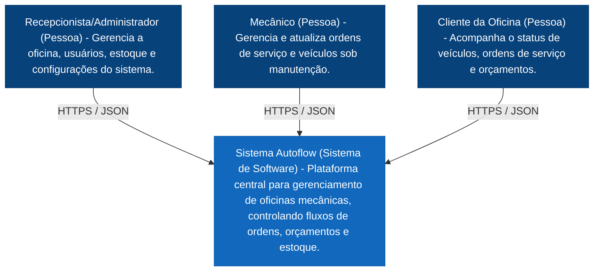
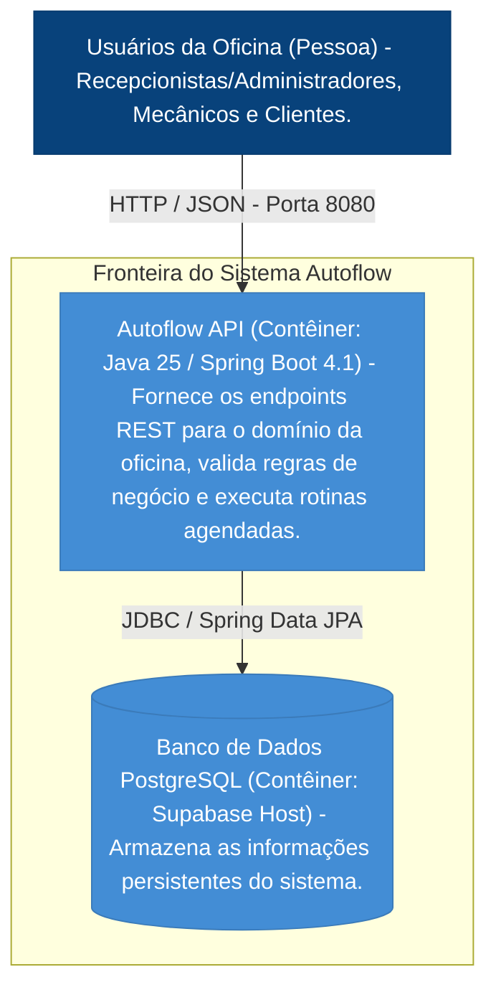
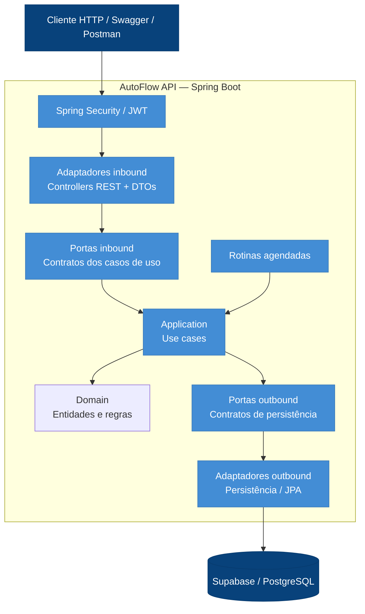
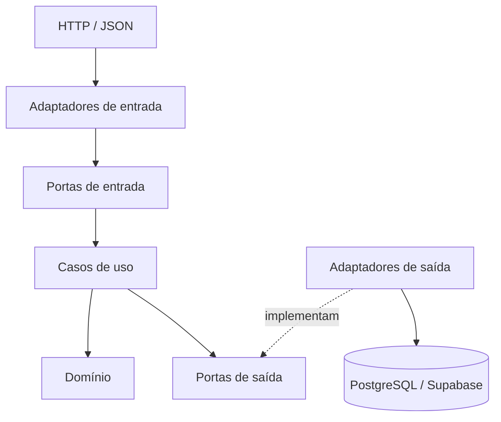
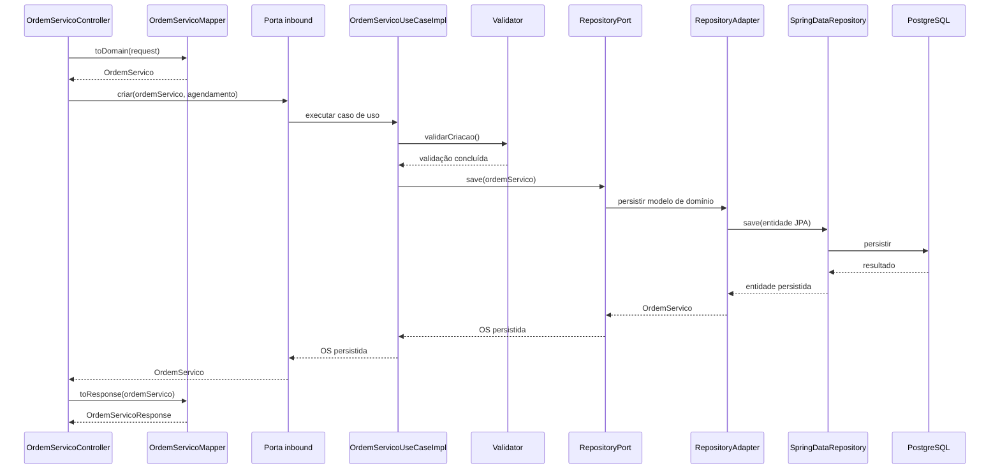
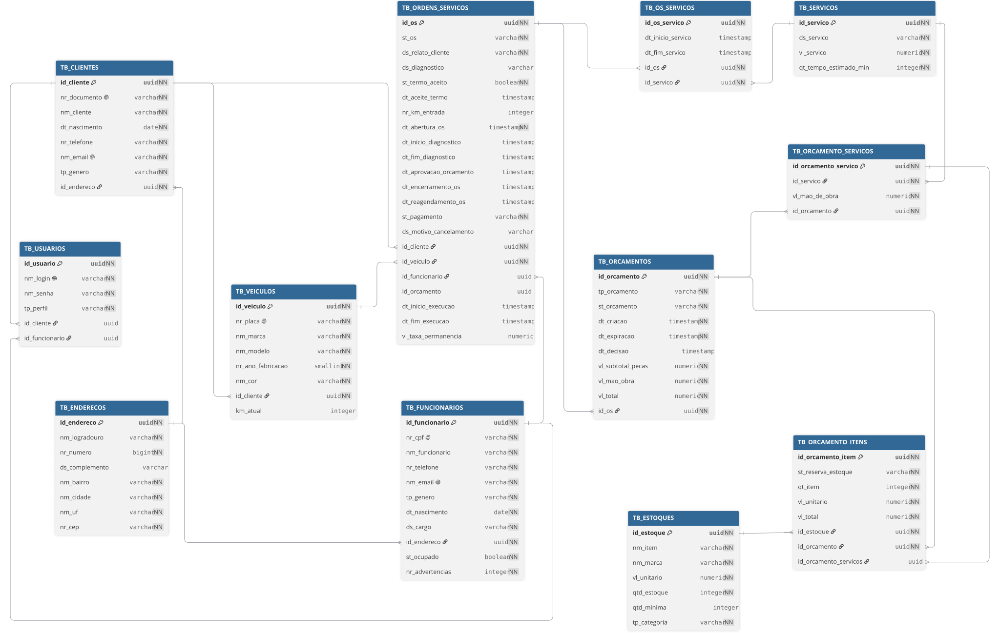
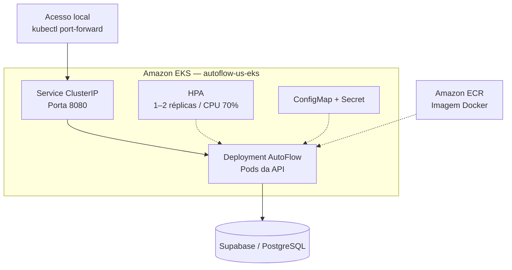
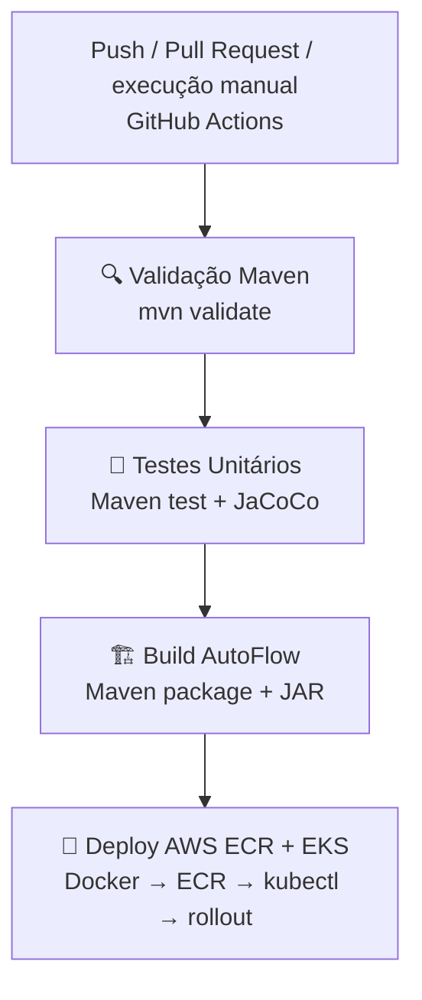

# Documentação Arquitetural - AutoFlow


Arquitetura técnica do sistema AutoFlow, incluindo visão de alto e baixo nível, estrutura da aplicação, persistência, segurança, testes e infraestrutura.

---
## 🗄️ Seções do Documento

| Seção | Subseções |
| --- | --- |
| [🎯 Visão Geral](#-visão-geral) | [Objetivo](#objetivo), [Stack Tecnológica](#stack-tecnológica) |
| [🗺️ High Level Design - HLD](#️-high-level-design---hld) | [Visão de Alto Nível](#visão-de-alto-nível), [Blocos da Arquitetura](#blocos-da-arquitetura) |
| [🗺️ Modelo C4](#️-modelo-c4) | [Nível 1: Contexto do Sistema](#nível-1-contexto-do-sistema), [Nível 2: Contêineres](#nível-2-contêineres), [Nível 3: Componentes](#nível-3-componentes) |
| [🏗️ Arquitetura da Aplicação](#️-arquitetura-da-aplicação) | [Organização Arquitetural](#organização-arquitetural), [Arquitetura Hexagonal](#arquitetura-hexagonal), [Organização do Código](#organização-do-código) |
| [🔎 Low Level Design - LLD](#-low-level-design---lld) | [Componentes da Aplicação](#componentes-da-aplicação), [Entidades do Domínio](#entidades-do-domínio), [Enums do Sistema](#enums-do-sistema), [Repositórios](#repositórios), [DTOs](#dtos), [Mappers](#mappers), [Casos de Uso](#casos-de-uso), [Segurança Interna](#segurança-interna), [Controllers REST](#controllers-rest), [Fluxos Técnicos](#fluxos-técnicos) |
| [🗃️ Banco de Dados](#️-banco-de-dados) | [Escolha do PostgreSQL](#escolha-do-postgresql), [Persistência](#persistência), [Modelo Entidade-Relacionamento](#modelo-entidade-relacionamento), [Consistência e Transações](#consistência-e-transações) |
| [🔐 Segurança](#-segurança) | [Autenticação](#autenticação), [Autorização](#autorização), [Validações](#validações), [Tratamento de Erros](#tratamento-de-erros) |
| [🧪 Testes e Qualidade](#-testes-e-qualidade) | [Estratégia de Testes](#estratégia-de-testes), [Cobertura de Testes](#cobertura-de-testes), [JaCoCo](#jacoco), [SonarQube](#sonarqube) |
| [🐳 Infraestrutura e Operação](#-infraestrutura-e-operação) | [Docker](#docker), [Docker Compose](#docker-compose), [Configuração por Ambiente](#configuração-por-ambiente), [Provisionamento com Terraform](#provisionamento-com-terraform), [Kubernetes e Escalabilidade](#kubernetes-e-escalabilidade), [Integração e Entrega Contínua (CI/CD)](#integração-e-entrega-contínua-cicd), [Operação e Observabilidade](#operação-e-observabilidade), [Custos e Desmobilização](#custos-e-desmobilização) |
| [📚 Referências](#-referências) | [ADR](#adr), [DAS](#das) |
---

## 🎯 Visão Geral

### Objetivo

Este documento descreve a arquitetura do **Autoflow**, consolidando a documentação técnica do sistema.

A documentação apresenta a solução em diferentes níveis de abstração, desde a interação dos atores com o sistema até os componentes internos responsáveis pela execução das principais operações.

### Stack Tecnológica

| Categoria | Tecnologia |
| --- | --- |
| Linguagem | Java 25 |
| Framework principal | Spring Boot 4.1.0 |
| Web | Spring Web MVC |
| Persistência | Spring Data JPA + Hibernate |
| Banco de dados | PostgreSQL (Supabase) |
| Segurança | Spring Security + JWT |
| Documentação da API | Springdoc OpenAPI / Swagger UI |
| Mapeamento | MapStruct |
| Boilerplate | Lombok |
| Build | Maven |
| Conteinerização | Docker / Docker Compose |
| Infraestrutura como código | Terraform |
| Nuvem | AWS (ECR, EKS, EC2 e VPC) |
| Orquestração | Kubernetes (Deployment, Service e HPA) |
| CI/CD | GitHub Actions |
| Qualidade | SonarQube + JaCoCo |
| Testes | JUnit / Spring Boot Test |

---

## 🗺️ High Level Design - HLD

### Visão de Alto Nível

O AutoFlow é uma aplicação Java com Spring Boot que centraliza os processos operacionais de uma oficina mecânica.

A Ordem de Serviço representa o principal elemento do fluxo operacional e conecta funcionalidades relacionadas a cliente, veículo, mecânico, orçamento, estoque, pagamento, histórico e métricas.

A solução é mantida em uma única aplicação executável, com separação de responsabilidades por casos de uso, portas de entrada, portas de saída e os adaptadores técnicos.


### Blocos da Arquitetura

O AutoFlow adota a arquitetura hexagonal (Ports and Adapters), separando as regras de negócio dos mecanismos de entrada, saída e infraestrutura. Essa organização favorece a manutenção, os testes e a evolução da aplicação sem acoplamento direto do núcleo aos componentes externos.

**Adaptadores de Entrada (Inbound Adapters):** Responsáveis por receber solicitações externas, interpretar os dados e encaminhar as operações aos casos de uso por meio das portas de entrada.

- **Componentes:**
    - Controllers REST;
    - Endpoints de autenticação e operações da oficina;
    - DTOs de requisição e resposta;
    - Documentação OpenAPI disponibilizada pelo Swagger UI.

**Portas de Entrada (Inbound Ports):** Definem os contratos de acesso às funcionalidades da aplicação, permitindo que os adaptadores de entrada acionem os casos de uso sem depender diretamente de suas implementações.

- **Responsabilidades:**
    - Definir as operações disponíveis para os consumidores;
    - Estabelecer os contratos dos casos de uso;
    - Desacoplar os controllers das implementações internas.

**Aplicação (Application):** Coordena a execução dos casos de uso e a interação entre o domínio e as portas de saída.

- **Responsabilidades:**
    - Orquestração dos fluxos operacionais;
    - Validação de pré-condições;
    - Gerenciamento das transições da Ordem de Serviço;
    - Processamento de orçamentos e estoque;
    - Consultas de métricas e histórico;
    - Coordenação das operações de clientes, veículos e funcionários.

**Domínio (Domain):** Concentra os conceitos e as regras de negócio da oficina, independentemente dos mecanismos de comunicação e persistência.

- **Componentes:**
    - Entidades e enums;
    - Estados e transições;
    - Regras do ciclo de vida da Ordem de Serviço;
    - Regras de aprovação e recusa de orçamentos;
    - Regras de reserva e movimentação de estoque.

**Portas de Saída (Outbound Ports):** Definem os contratos utilizados pela aplicação para acessar recursos externos, sem depender diretamente das tecnologias empregadas.

- **Responsabilidades:**
    - Abstrair operações de persistência;
    - Definir interfaces para consultas e gravações;
    - Desacoplar os casos de uso das implementações de infraestrutura.

**Adaptadores de Saída (Outbound Adapters):** Implementam as portas de saída e realizam a integração com os mecanismos externos necessários à aplicação.

- **Componentes:**
    - Implementações de persistência;
    - Spring Data JPA e Hibernate;
    - Integração JDBC com PostgreSQL hospedado no Supabase;
    - Mapeamento entre objetos de domínio e persistência, quando aplicável.

**Adapters de Configuração e Segurança:** Reúnem os componentes transversais responsáveis pela integração técnica e pela proteção da aplicação.

- **Componentes:**
    - Configuração e injeção de dependências do Spring;
    - Spring Security;
    - Autenticação e autorização JWT;
    - Filtros de segurança;
    - Configuração dos adaptadores e suas dependências.

---

## 🗺️ Modelo C4

O Modelo C4 é utilizado para representar a arquitetura em diferentes níveis de abstração.

### Nível 1: Contexto do Sistema

Neste nível, o AutoFlow é tratado como uma única unidade de software e são representados apenas os atores que interagem diretamente com ele.

---



---

### Nível 2: Contêineres

Neste nível, o AutoFlow é decomposto em seus principais contêineres executáveis e de persistência, evidenciando como os usuários interagem com a API e como a aplicação se comunica com o banco de dados.

---



---

### Nível 3: Componentes

Detalhamento interno do contêiner **AutoFlow API**, refletindo a separação atual entre adaptadores, portas, aplicação e domínio.

---



---

## 🏗️ Arquitetura da Aplicação

### Organização Arquitetural

A aplicação está organizada em responsabilidades técnicas bem definidas:

- **Adaptadores de Entrada (Inbound Adapters):** Recepção das requisições HTTP, controllers e DTOs de API;
- **Portas de Entrada (Inbound Ports):** Contratos para acionamento dos casos de uso;
- **Application Usecases (Casos de Uso):** Coordenação e execução dos casos de uso;
- **Domain:** Entidades, enums e regras de negócio;
- **Portas de Saída (Outbound Ports):** Contratos exigidos pela aplicação para persistência e integrações;
- **Adaptadores de Saída (Outbound Adapters):** Implementações técnicas das portas de saída;
- **Adapters de Configuração e Segurança:** Configuração de componentes e integrações Spring;

### Arquitetura Hexagonal

A aplicação implementa a arquitetura hexagonal por meio de portas de entrada e saída, casos de uso e adaptadores:

---



---

| Área | Responsabilidade |
| --- | --- |
| `adapters/inbound` | Recepção das requisições HTTP, controllers e DTOs de API |
| `ports/inbound` | Contratos para acionamento dos casos de uso |
| `application/usecase` | Coordenação e execução dos casos de uso |
| `domain` | Entidades, enums e regras de negócio |
| `ports/outbound` | Contratos exigidos pela aplicação para persistência e integrações |
| `adapters/outbound` | Implementações técnicas das portas de saída |
| `adapters/config` | Configuração de componentes e integrações Spring |

### Organização do Código

```text
├── infra/
│   ├── estado-aws-academy/     # Ambiente AWS Academy
│   └── main.tf
│
├── k8s/
│   ├── tests/load/
│   ├── configmap.yaml
│   ├── deployment.yaml
│   ├── docker-compose.yaml
│   ├── Dockerfile
│   ├── hpa.yaml
│   ├── secret.yaml
│   └── service.yaml
│
├── src/
│   └── main/
│       └── java/br/com/autoflow/
│           ├── adapters/
│           │   ├── config/
│           │   ├── inbound/
│           │   │   ├── controller/
│           │   │   └── mapper/
│           │   └── outbound/
│           │       ├── persistence/
│           │       └── security/
│           ├── application/
│           │   ├── usecase/
│           │   └── validator/
│           ├── domain/
│           │   ├── enums/
│           │   ├── exception/
│           │   └── model/
│           └── ports/
│                ├── inbound/
│                └── outbound/
│
└── test/
    └── java/br/com/autoflow/
        ├── adapters/
        │   ├── config/
        │   ├── inbound/
        │   │   ├── controller/
        │   │   └── mapper/
        │   └── outbound/
        │       ├── persistence/
        │       └── security/
        ├── application/
        │   ├── usecase/
        │   └── validator/
        ├── domain/
        │   ├── enums/
        │   ├── exception/
        │   └── model/
        └── ports/
             ├── inbound/
             └── outbound/
```

---

## 🔎 Low Level Design - LLD

O Low Level Design detalha a implementação interna da aplicação, seus componentes e as interações entre as camadas.

O inventário técnico de entidades, enums, portas de repositório, DTOs, mappers, casos de uso e componentes internos de segurança está disponível de forma expansível para preservar o detalhamento da implementação sem comprometer a leitura principal do documento.

Os controllers, endpoints e fluxos técnicos permanecem visíveis por representarem os principais contratos e caminhos de execução da aplicação.

### Componentes da Aplicação

<details>
<summary><strong>Ver detalhamento técnico das classes e componentes</strong></summary>

<br>

### Entidades do Domínio

#### Cliente

**Package:** `br.com.autoflow.domain.model`

**Atributos:**

- `UUID id`
- `String nome`
- `String documento`
- `String email`
- `LocalDate dataNascimento`
- `String telefone`
- `Genero genero`
- `Endereco endereco`

**Relacionamentos:**

- Mantém o endereço como objeto de domínio;
- Ordens de serviço e veículos são associados por seus identificadores nos fluxos da aplicação.

**Métodos principais:**

- não há lógica de negócio complexa no modelo; a entidade funciona como estrutura principal de cliente.

#### Endereco

**Atributos:**

- `UUID id`
- `String cep`
- `String uf`
- `String cidade`
- `String bairro`
- `String logradouro`
- `Integer numero`
- `String complemento`

**Observações:**

- Objeto de domínio utilizado nos cadastros de cliente e funcionário;
- Os mapeamentos JPA ficam nas classes de persistência, não neste modelo.

#### Funcionario

**Atributos:**

- `UUID id`
- `String cpf`
- `String nome`
- `String telefone`
- `String email`
- `Genero genero`
- `LocalDate dataNascimento`
- `Cargo cargo`
- `Endereco endereco`
- `boolean ocupado`
- `int nrAdvertencias`

**Métodos principais:**

- `void ocupar()` → marca `ocupado = true`;
- `void liberar()` → marca `ocupado = false`;
- `void adicionarAdvertencia()` → incrementa `nrAdvertencias`;
- `boolean deveSerDemitido()` → retorna `true` quando `nrAdvertencias >= 3`.

**Responsabilidade:**

Representa o colaborador responsável por serviços e diagnósticos e que pode ser associado a uma conta de usuário.

#### Usuario

**Package:** `br.com.autoflow.domain.model`

**Atributos:**

- `UUID id`
- `String login`
- `String senha`
- `Perfil perfil`
- `Cliente cliente`
- `Funcionario funcionario`

**Observação:** `Usuario` é um modelo de domínio simples. A implementação de `UserDetails` fica no adaptador `UserDetailsImpl`, em `adapters.outbound.security`.

**Responsabilidade:**

Entidade utilizada no processo de autenticação e autorização do sistema.

#### Veiculo

**Atributos:**

- `UUID id`
- `String placa`
- `String modelo`
- `String marca`
- `Integer kmAtual`
- `Short anoFabricacao`
- `String cor`
- `UUID clienteId`

**Responsabilidade:**

Representa o veículo associado ao cliente e aos atendimentos realizados pela oficina.

#### Servico

**Atributos:**

- `UUID idServico`
- `String dsServico`
- `BigDecimal vlServico`
- `Integer qtTempoEstimadoMin`

**Responsabilidade:**

Representa o catálogo de serviços disponíveis para composição dos orçamentos e execução da OS.

#### Estoque

**Atributos:**

- `UUID id`
- `String nomeItem`
- `String nomeMarca`
- `BigDecimal valorUnitario`
- `Integer quantidadeEstoque`
- `Integer quantidadeMinima`
- `TipoItemEstoque tipoCategoria`

**Métodos principais:**

- `boolean deveDispararAlertaEstoqueBaixo()`

**Responsabilidade:**

Controla os itens de estoque e as regras relacionadas ao nível mínimo de peças e insumos.

#### Orcamento

**Atributos:**

- `UUID id`
- `TipoOrcamento tipoOrcamento`
- `StatusOrcamento status`
- `LocalDateTime dataCriacao`
- `LocalDateTime dataExpiracao`
- `LocalDateTime dataDecisao`
- `BigDecimal subtotalPecas`
- `BigDecimal maoObra`
- `BigDecimal total`
- `OrdemServico ordemServico`
- `List<OrcamentoServico> servicos`
- `List<OrcamentoItem> itens`

**Métodos principais:**

- `void aprovar()`
- `void recusar()`
- `void expirar()`
- `void aplicarNovoStatus(StatusOrcamento novoStatus)`
- `void atualizarStatusReservaItens(StatusReservaEstoque status)`
- `void validarMudancaStatus()`
- `void recalcularTotais()`

**Responsabilidade:**

Representa a proposta técnica e financeira relacionada à Ordem de Serviço e mantém seus itens, serviços, valores e estado.

#### OrcamentoServico

**Atributos:**

- `UUID id`
- `BigDecimal maoDeObra`
- `Servico servico`
- `List<OrcamentoItem> itens`
- `Orcamento orcamento`

**Responsabilidade:**

Representa um serviço incluído em determinado orçamento.

#### OrcamentoItem

**Atributos:**

- `UUID id`
- `StatusReservaEstoque statusReserva`
- `Integer quantidade`
- `BigDecimal valorUnitario`
- `BigDecimal valorTotal`
- `UUID idEstoque`
- `OrcamentoServico orcamentoServico`
- `Orcamento orcamento`

**Observações:**

- `idEstoque` é armazenado como UUID;
- quando necessário, o item correspondente é recuperado através do repository de estoque.

#### OrdemServico

**Atributos principais:**

- `UUID idOs`
- `StatusOS statusOS`
- `String dsRelatoCliente`
- `String dsDiagnostico`
- `Boolean stTermoAceito`
- `LocalDateTime dtAceiteTermo`
- `Integer nrKmEntrada`
- `LocalDateTime dtAberturaOs`
- `LocalDateTime dtInicioDiagnostico`
- `LocalDateTime dtFimDiagnostico`
- `LocalDateTime dtAprovacaoOrcamento`
- `LocalDateTime dataInicioExecucao`
- `LocalDateTime dataFimExecucao`
- `LocalDateTime dtEncerramentoOs`
- `LocalDateTime dtReagendamentoOs`
- `StatusPagamento stPagamento`
- `String dsMotivoCancelamento`
- `BigDecimal taxaPermanencia`
- `UUID idCliente`
- `UUID idVeiculo`
- `UUID idFuncionario`
- `List<Orcamento> idsOrcamento`
- `List<OsServico> servicosExecucao`

**Métodos principais:**

- `void inicializarDadosPadrao()`
- `void carregarServicosDosOrcamentosAprovados()`
- `void atualizarStatus(StatusOS novoStatus, String observacao)`
- `Long getTempoTotalExecucaoMinutos()`
- `Long getTempoTotalEstimadoMinutos()`
- `Long getDiferencaMinutos()`
- `void aprovarOrcamentosVinculados(LocalDateTime dataAprovacao)`
- `void recusarOrcamentosVinculados()`
- `void verificarCancelamentoAutomatico(int diasLimite, BigDecimal valorDiaria)`
- `void verificarAbandonoTecnico(int diasLimiteAbandono)`

**Responsabilidade:**

Representa o centro do processo operacional da oficina e coordena o ciclo de vida do atendimento.

#### OrdemHistoricoDomain

Record de domínio que representa o resumo de uma OS e seus serviços e peças na consulta paginada de histórico por veículo.

#### OsServico

**Atributos:**

- `UUID id`
- `OrdemServico ordemServico`
- `Servico servico`
- `LocalDateTime dataInicioExecucao`
- `LocalDateTime dataFimExecucao`

**Responsabilidade:**

Representa a execução de um serviço dentro de uma Ordem de Serviço.

### Enums do Sistema

Os principais enums estão em `br.com.autoflow.domain.enums`.

**Principais enums:**

- `StatusOS`
- `StatusOrcamento`
- `StatusReservaEstoque`
- `TipoItemEstoque`
- `Perfil`
- `Cargo`
- `Genero`
- `TipoOrcamento`
- `StatusPagamento`

Esses elementos representam estados, classificações e permissões utilizadas pelos fluxos da aplicação.

### Repositórios

As portas em `br.com.autoflow.ports.outbound` definem os contratos usados pelos casos de uso. Os adaptadores em `adapters.outbound.persistence` convertem modelos de domínio em entidades e delegam a persistência às interfaces Spring Data JPA em `adapters.outbound.persistence.repository`.

| Port | Adapter de persistência |
| --- | --- |
| `ClienteRepositoryPort` | `ClienteRepositoryAdapter` |
| `EnderecoRepositoryPort` | `EnderecoRepositoryAdapter` |
| `EstoqueRepositoryPort` | `EstoqueRepositoryAdapter` |
| `FuncionarioRepositoryPort` | `FuncionarioRepositoryAdapter` |
| `OrcamentoItemRepositoryPort` | `OrcamentoItemRepositoryAdapter` |
| `OrcamentoRepositoryPort` | `OrcamentoRepositoryAdapter` |
| `OrcamentoServicoRepositoryPort` | `OrcamentoServicoRepositoryAdapter` |
| `OrdemServicoRepositoryPort` | `OrdemServicoRepositoryAdapter` |
| `OsServicoRepositoryPort` | `OsServicoRepositoryAdapter` |
| `ServicoRepositoryPort` | `ServicoRepositoryAdapter` |
| `UsuarioRepositoryPort` | `UsuarioRepositoryAdapter` |
| `VeiculoRepositoryPort` | `VeiculoRepositoryAdapter` |

### DTOs

Os DTOs da API ficam em `br.com.autoflow.adapters.inbound.controller.dto`.

#### Estoque

- `EstoqueRequest`
- `EstoqueResponse`
- `AdicionarEstoqueRequest`
- `AtualizarValorEstoqueRequest`

#### Orçamento

- `OrcamentoRequest`
- `OrcamentoResponse`
- `OrcamentoItemRequest`
- `OrcamentoItemResponse`
- `OrcamentoServicoRequest`
- `OrcamentoServicoResponse`
- `AtualizarStatusOrcamentoRequest`

#### Ordem de Serviço

- `OrdemServicoRequest`
- `OrdemServicoResponse`
- `AtualizarStatusOSRequest`
- `AtualizarStatusPagamentoRequest`
- `MetricaOsResponse`
- `HistoricoVeiculoResponse`
- `OsServicoResponse`

#### Autenticação

- `LoginRequest`
- `TokenResponse`

#### Cliente e endereço

- `ClienteRequest`
- `ClienteResponse`
- `ClienteUpdateRequest`
- `EnderecoRequest`
- `EnderecoResponse`

#### Serviço, Veículo e Funcionário

- `ServicoRequest`
- `ServicoResponse`
- `VeiculoRequest`
- `VeiculoResponse`
- `FuncionarioRequest`
- `FuncionarioResponse`

### Mappers

Os mappers da API ficam em `adapters.inbound.mapper` e convertem DTOs em modelos de domínio e vice-versa. Os mappers em `adapters.outbound.persistence.mapper` convertem modelos de domínio em entidades JPA e vice-versa. Ambos utilizam MapStruct.

**Mappers principais:**

- `EstoqueMapper`
- `OrcamentoMapper`
- `OrcamentoItemMapper`
- `OrcamentoServicoMapper`
- `OrdemServicoMapper`
- `ServicoMapper`
- `VeiculoMapper`
- `FuncionarioMapper`
- `ClienteMapper`
- `EnderecoMapper`
- `OsServicoMapper`

Os mappers de persistência têm versões correspondentes para as entidades de cliente, endereço, estoque, funcionário, orçamento, itens e serviços do orçamento, ordem de serviço, serviço, usuário e veículo.

**Responsabilidades:**

- converter DTOs da API em modelos de domínio e respostas;
- converter modelos de domínio em entidades JPA e vice-versa;
- manter os modelos de domínio independentes dos detalhes de persistência.

### Casos de Uso

As implementações ficam em `br.com.autoflow.application.usecase` e implementam contratos das portas inbound.

| Implementação | Responsabilidade |
| --- | --- |
| `ClienteUseCaseImpl` e `EnderecoUseCaseImpl` | Cadastro, consulta, atualização e exclusão de clientes e endereços |
| `EstoqueUseCaseImpl` | Cadastro, consulta, atualização de quantidade e preço e alerta de estoque baixo |
| `FuncionarioUseCaseImpl` | Cadastro, consulta, atualização, exclusão e registro de advertência |
| `OrcamentoUseCaseImpl` | Criação, consulta, exclusão e atualização do status de orçamentos, incluindo interação com estoque |
| `OrdemServicoUseCaseImpl` | Ciclo de vida da OS, alocação de funcionário, métricas, histórico e rotinas agendadas |
| `ServicoUseCaseImpl` e `VeiculoUseCaseImpl` | Operações de cadastro e consulta de serviços e veículos |
| `OrcamentoExpiradoUseCase` | Persistência do orçamento expirado em transação independente |

As validações específicas ficam em `br.com.autoflow.application.validator`, com validadores para cliente, endereço, funcionário, orçamento, ordem de serviço, serviço e veículo.

### Segurança Interna

#### AutenticacaoService e UserDetailsImpl

`AutenticacaoService` implementa `UserDetailsService`, busca o usuário por login usando `UsuarioRepositoryPort` e o adapta para `UserDetailsImpl`. Esse adaptador fornece as authorities correspondentes ao perfil do usuário.

#### TokenService

**Atributos:**

- `String secret`
- `Long expirationMinutes`

**Métodos principais:**

- `String gerarToken(Usuario usuario)`
- `String validarToken(String token)`

**Responsabilidade:**

Gerar e validar tokens JWT utilizados pela API.

#### SecurityFilter

**Métodos principais:**

- recuperação privada do token Bearer do cabeçalho `Authorization`
- `doFilterInternal(HttpServletRequest request, HttpServletResponse response, FilterChain chain)`

**Responsabilidade:**

Interceptar as requisições e aplicar o processo de autenticação.

#### SecurityConfigurations

**Responsabilidade:**

Definir a política stateless, os endpoints públicos e as autorizações por método HTTP e perfil.

**Regras relevantes:**

- `POST /auth/login`, documentação OpenAPI/Swagger e `/actuator/**` → públicos;
- operações `DELETE` → perfil `ADMIN`;
- consultas de OS, veículos, orçamentos e serviços → perfis `ADMIN`, `MECANICO` ou `CLIENTE`;
- criação e atualização de OS, veículos, orçamentos e serviços → perfis `ADMIN` ou `MECANICO`;
- demais endpoints → exigem autenticação.

</details>

### Controllers REST

Os controllers representam a interface HTTP e delegam a execução às portas inbound, mapeando os DTOs para os modelos de domínio.

###### NOTA: Os contratos completos, schemas, payloads e respostas HTTP permanecem disponíveis através do Springdoc OpenAPI e Swagger UI.

#### Autenticação

| Método | Endpoint | Responsabilidade |
| --- | --- | --- |
| `POST` | `/auth/login` | Autenticar o usuário e retornar um token JWT |

#### Estoque

**Base path:** `/estoque`

| Método | Endpoint | Responsabilidade |
| --- | --- | --- |
| `POST` | `/estoque` | Cadastrar item |
| `GET` | `/estoque` | Listar itens |
| `GET` | `/estoque/estoque-baixo` | Listar insumos com estoque baixo |
| `GET` | `/estoque/{id}` | Consultar item |
| `PATCH` | `/estoque/{id}/adicionar-quantidade` | Adicionar quantidade |
| `PATCH` | `/estoque/{id}/valor-unitario` | Atualizar valor unitário |
| `PUT` | `/estoque/{id}` | Atualizar item |

#### Orçamentos

**Base path:** `/orcamentos`

| Método | Endpoint | Responsabilidade |
| --- | --- | --- |
| `POST` | `/orcamentos` | Criar orçamento |
| `GET` | `/orcamentos` | Listar orçamentos |
| `GET` | `/orcamentos/{id}` | Consultar orçamento |
| `DELETE` | `/orcamentos/{id}` | Excluir orçamento |
| `PATCH` | `/orcamentos/{id}/status` | Alterar status |
| `GET` | `/orcamentos/ordem-servico/{idOs}` | Consultar os orçamentos de uma OS |
| `POST` | `/orcamentos/webhook/{id}/resposta?statusResposta={status}` | Receber resposta externa de aprovação ou recusa |

#### Clientes

**Base path:** `/clientes`

| Método | Endpoint | Responsabilidade |
| --- | --- | --- |
| `POST` | `/clientes` | Cadastrar cliente |
| `GET` | `/clientes` | Listar clientes |
| `GET` | `/clientes/{id}` | Consultar cliente |
| `GET` | `/clientes/documento/{documento}` | Consultar cliente pelo documento |
| `PUT` | `/clientes/{id}` | Atualizar cliente |
| `DELETE` | `/clientes/{id}` | Excluir cliente |

#### Endereços

**Base path:** `/enderecos`

| Método | Endpoint | Responsabilidade |
| --- | --- | --- |
| `POST` | `/enderecos` | Cadastrar endereço |
| `GET` | `/enderecos` | Listar endereços |
| `GET` | `/enderecos/{id}` | Consultar endereço |
| `PUT` | `/enderecos/{id}` | Atualizar endereço |
| `DELETE` | `/enderecos/{id}` | Excluir endereço |

#### Ordens de Serviço

**Base path:** `/ordens-servico`

| Método | Endpoint | Responsabilidade |
| --- | --- | --- |
| `GET` | `/ordens-servico/ativas` | Listar OS ativas (paginado) |
| `GET` | `/ordens-servico/todas` | Listar todas as OS (paginado) |
| `GET` | `/ordens-servico/filtro-status?status={status}` | Filtrar OS por status |
| `GET` | `/ordens-servico/{id}` | Consultar OS |
| `POST` | `/ordens-servico?agendamento={boolean}` | Criar OS; `agendamento` assume `false` por padrão |
| `PUT` | `/ordens-servico/{id}` | Atualizar OS |
| `PATCH` | `/ordens-servico/{id}/status` | Atualizar status |
| `PATCH` | `/ordens-servico/{id}/pagamento` | Atualizar pagamento |
| `GET` | `/ordens-servico/{idOs}/metricas` | Obter métricas da OS |
| `GET` | `/ordens-servico/metricas` | Consultar métricas (paginado e filtrável por datas/status) |
| `GET` | `/ordens-servico/veiculo/{idVeiculo}/historico` | Consultar histórico do veículo (paginado) |
| `DELETE` | `/ordens-servico/{id}` | Excluir OS |
| `POST` | `/ordens-servico/processar-cancelamentos` | Acionar processamento de cancelamentos |

#### Serviços

**Base path:** `/servicos`

| Método | Endpoint | Responsabilidade |
| --- | --- | --- |
| `POST` | `/servicos` | Criar serviço |
| `GET` | `/servicos` | Listar serviços (paginado) |
| `GET` | `/servicos/{id}` | Consultar serviço |
| `PUT` | `/servicos/{id}` | Atualizar serviço |
| `DELETE` | `/servicos/{id}` | Excluir serviço |

#### Veículos

**Base path:** `/veiculos`

| Método | Endpoint | Responsabilidade |
| --- | --- | --- |
| `POST` | `/veiculos` | Cadastrar veículo |
| `GET` | `/veiculos` | Listar veículos |
| `GET` | `/veiculos/{id}` | Consultar veículo |
| `GET` | `/veiculos/placa/{placa}` | Consultar veículo pela placa |
| `PUT` | `/veiculos/{id}` | Atualizar veículo |
| `DELETE` | `/veiculos/{id}` | Excluir veículo |

#### Funcionários

**Base path:** `/funcionarios`

| Método | Endpoint | Responsabilidade |
| --- | --- | --- |
| `POST` | `/funcionarios` | Cadastrar funcionário |
| `GET` | `/funcionarios` | Listar funcionários |
| `GET` | `/funcionarios/{id}` | Consultar funcionário |
| `GET` | `/funcionarios/cpf/{cpf}` | Consultar funcionário pelo CPF |
| `PUT` | `/funcionarios/{id}` | Atualizar funcionário |
| `DELETE` | `/funcionarios/{id}` | Excluir funcionário |
| `PATCH` | `/funcionarios/{id}/advertencia` | Registrar advertência |

### Fluxos Técnicos

#### Criação da Ordem de Serviço

---



---

## 🗃️ Banco de Dados

### Escolha do PostgreSQL

O PostgreSQL foi escolhido como banco de dados relacional da aplicação.

O domínio possui diversas operações que dependem da consistência entre registros relacionados, principalmente nos fluxos envolvendo:

* Ordens de Serviço e seus estados;
* Clientes e veículos;
* Orçamentos e seus itens;
* Serviços;
* Reserva e movimentação de estoque;
* Pagamento;
* Histórico dos atendimentos.

A abordagem relacional permite representar essas associações de forma estruturada e aplicar restrições de integridade entre os dados persistidos.

### Persistência

A persistência utiliza:

* PostgreSQL;
* Spring Data JPA;
* Hibernate;
* JDBC para comunicação entre a aplicação e o banco.

Os repositories abstraem as operações de persistência e concentram consultas específicas utilizadas pelos fluxos da aplicação.

Os modelos em `domain.model` são objetos de domínio sem anotações JPA. O mapeamento relacional fica separado em `adapters.outbound.persistence.entity`, com entidades para clientes, endereços, estoque, funcionários, orçamentos, itens e serviços de orçamento, ordens de serviço, serviços executados, serviços, usuários e veículos. Os adapters e mappers de persistência fazem a conversão entre esses modelos.

### Modelo Entidade-Relacionamento

O Modelo Entidade-Relacionamento representa a estrutura de persistência do AutoFlow e as relações entre as entidades armazenadas no PostgreSQL.

---



---

**Principais grupos representados:**

* Usuários;
* Clientes;
* Funcionários;
* Endereços;
* Veículos;
* Serviços;
* Ordens de Serviço;
* Orçamentos;
* Serviços de orçamento;
* Itens de orçamento;
* Estoque;
* Serviços em execução.

###### NOTA: O diagrama deve refletir o modelo efetivamente persistido. As classes JPA ficam em `adapters.outbound.persistence.entity`; alterações nessas entidades ou em seus relacionamentos devem ser acompanhadas pela atualização do diagrama.

### Consistência e Transações

Algumas operações modificam múltiplos elementos relacionados e precisam preservar a consistência dos dados.

Os principais casos são:

* Criação e atualização da Ordem de Serviço;
* Aprovação ou recusa de orçamento;
* Associação de serviços;
* Reserva de estoque;
* Baixa de estoque;
* Devolução de itens;
* Alteração da situação de pagamento.

O Spring Data JPA e o gerenciamento transacional do Spring são utilizados para suportar essas operações.

---

## 🔐 Segurança

### Autenticação

A aplicação utiliza Spring Security e JWT com política stateless. O token registra o login como subject, o perfil e, quando aplicável, o identificador do cliente ou funcionário.

O token é validado antes do processamento das rotas protegidas e identifica o usuário e suas autorizações.

### Autorização

O acesso aos endpoints é controlado pelo perfil associado ao usuário.

Os perfis representam:

* Recepcionista através do perfil administrativo;
* Mecânico;
* Cliente.

**Mecanismos utilizados:**

* Spring Security;
* Filtro JWT;
* Autorização por perfil;
* `BCryptPasswordEncoder`.

### Validações

A aplicação possui validações distribuídas em diferentes níveis:

* Bean Validation nos DTOs;
* Validações nos casos de uso;
* Validações específicas do domínio;
* Validações de transição de status;
* Restrições relacionadas ao estado atual das entidades.

### Tratamento de Erros

`GlobalExceptionHandler` centraliza o tratamento das exceções da API.

Essa abordagem padroniza as respostas de erro e evita que controllers implementem individualmente o tratamento das mesmas situações.

---

## 🧪 Testes e Qualidade

### Estratégia de Testes

Os testes automatizados estão localizados em:

`src/test/java`

A suíte contempla componentes relacionados a:

* Regras da aplicação;
* Casos de uso;
* Controllers;
* Autenticação;
* Autorização;
* Segurança;
* Fluxos operacionais relevantes.

Os testes são utilizados para validar tanto comportamentos isolados quanto a integração entre os principais componentes.

### Cobertura de Testes

A cobertura é acompanhada para identificar quais partes do código são exercitadas pela suíte automatizada.

Na avaliação realizada sobre o MVP, foi registrada cobertura de **84,2%**.

###### NOTA: A cobertura representa uma medição do estado do projeto no momento da análise e pode variar conforme o código e os testes evoluem.

### JaCoCo

O projeto utiliza JaCoCo para coleta e geração das métricas de cobertura.

Os relatórios podem ser utilizados localmente e integrados às análises realizadas pelo SonarQube.

### SonarQube

O SonarQube é utilizado para análise estática do projeto.

Entre as métricas acompanhadas estão:

* Segurança;
* Confiabilidade;
* Manutenibilidade;
* Hotspots de segurança;
* Cobertura;
* Duplicação de código.

Os comandos necessários para execução dos testes, geração de cobertura e análise com SonarQube estão centralizados no `README.md`.

---

## 🐳 Infraestrutura e Operação

### Docker

O projeto mantém um `Dockerfile` multi-stage em `k8s/Dockerfile`, separando a etapa de compilação da etapa de execução da aplicação Java. A imagem resultante é publicada no Amazon ECR e consumida pelo Deployment Kubernetes.

### Docker Compose

O arquivo `k8s/docker-compose.yaml` reúne os serviços utilizados no ambiente local, incluindo `autoflow-app` e SonarQube. O contexto de build é a raiz do repositório (`..`) e o Dockerfile é `k8s/Dockerfile`. As variáveis locais são lidas de `k8s/.env`; `k8s/.env.example` documenta os nomes esperados sem fornecer credenciais.

Os comandos operacionais permanecem centralizados no `README.md`.

### Configuração por Ambiente

As configurações de execução são fornecidas externamente à aplicação, incluindo URL e credenciais PostgreSQL, segredo JWT e parâmetros operacionais. No Kubernetes, a configuração é distribuída entre `ConfigMap` e `Secret`.

###### NOTA: Valores sensíveis não devem ser versionados em texto puro. O workflow de CI/CD não aplica `k8s/secret.yaml`; o Secret `autoflow-secrets` precisa existir no cluster antes da implantação da API.

### Provisionamento com Terraform

A infraestrutura AWS é definida em `infra/main.tf` e provisionada na região `us-east-2` (Ohio).

| Recurso | Configuração |
| --- | --- |
| Amazon ECR | Repositório `autoflow-us` |
| Amazon EKS | Cluster `autoflow-us-eks` |
| Managed Node Group | `autoflow-us-nodes` |
| Instância EC2 | `m7i-flex.large` |
| Capacidade do node group | Mínima 1, desejada 1 e máxima 2 |
| Rede | VPC e sub-redes padrão da conta AWS |

As roles IAM usadas pelo EKS e pelo grupo de nós são consultadas pelo Terraform e devem existir previamente. O banco PostgreSQL continua hospedado externamente no Supabase.

### Kubernetes e Escalabilidade

| Manifest | Responsabilidade |
| --- | --- |
| `k8s/deployment.yaml` | Implantação dos pods da API AutoFlow |
| `k8s/service.yaml` | Service `autoflow-service`, tipo `ClusterIP`, porta 8080 |
| `k8s/configmap.yaml` | Configurações não sensíveis da aplicação |
| `k8s/secret.yaml` | Manifesto de referência para os dados sensíveis consumidos pelo Deployment |
| `k8s/hpa.yaml` | Escalabilidade horizontal com 1 a 2 réplicas, alvo de 70% de CPU |

O HPA utiliza métricas de utilização de CPU; para funcionar, depende da disponibilidade de métricas no cluster, fornecidas pelo Metrics Server. No ambiente utilizado para a Fase 2, o Metrics Server foi instalado separadamente, por meio de um add-on do EKS.

---



---

O `ClusterIP` não expõe a API publicamente. Para acesso local ao cluster, é possível utilizar `kubectl port-forward service/autoflow-service 8080:8080`.

### Integração e Entrega Contínua (CI/CD)

O workflow `.github/workflows/ci-cd.yml` é acionado por push em `master`, `main`, `develop`, `dev_carol_newArq`, `dev_thalita_newArq` e `dev_bruna_newArq`, pull requests para `master` ou `main` e execução manual. Os jobs são encadeados: testes aguardam a validação, o build aguarda os testes e o deploy aguarda o build.

---



---

| Job | Etapas principais | Resultado |
| --- | --- | --- |
| `lint` | Configura Java 25 e executa `mvn validate` | Validação Maven; falhas não interrompem este job |
| `test` | Executa `mvn clean test` com a chave JWT configurada no GitHub Actions | Testes e relatório de cobertura JaCoCo |
| `build` | Executa `mvn package -DskipTests` | JAR publicado como artefato por 14 dias |
| `deploy-aws` | Autentica na AWS, constrói e envia a imagem Docker, aplica manifests no EKS e verifica o rollout | Atualização do Deployment e consulta de deployments, pods e HPA |

O deploy constrói uma nova imagem usando `k8s/Dockerfile` e publica a tag mutável `latest`; não reutiliza o JAR publicado pelo job `build`. Em seguida, atualiza o kubeconfig, aplica ConfigMap, Service, Deployment e HPA, reinicia o Deployment e aguarda até cinco minutos pelo rollout. São necessárias credenciais AWS e permissões para publicar no ECR e operar o cluster.

###### NOTA: O job denominado `lint` executa apenas `mvn validate`; o `pom.xml` não configura um plugin específico de lint ou análise estática, e a etapa está marcada com `continue-on-error: true`. O job de deploy não restringe evento ou branch, portanto também entra no fluxo de pull requests que atinjam essa etapa; sua execução depende da disponibilidade das credenciais AWS necessárias.

### Operação e Observabilidade

O estado dos pods e da implantação pode ser consultado por `kubectl get pods`, `kubectl rollout status deployment/autoflow` e `kubectl get hpa`. Os logs dos containers podem ser consultados por `kubectl logs`.

A configuração do HPA permite demonstrar o ajuste automático da quantidade de réplicas de acordo com a utilização de CPU, dentro dos limites definidos no manifest.

O `OrdemServicoUseCaseImpl` também executa duas rotinas agendadas: às 8h processa cancelamentos de OS aguardando aprovação há pelo menos três dias, e às 9h verifica abandono técnico após 60 dias.

###### NOTA: Como as rotinas agendadas são executadas pela aplicação, múltiplas réplicas podem processar a mesma tarefa. O código não implementa mecanismo de eleição de líder ou trava distribuída; a configuração atual do HPA permite até duas réplicas.

### Custos e Desmobilização

O cluster EKS e as instâncias EC2 podem gerar custos enquanto permanecerem ativos. Após testes e demonstrações, a infraestrutura deve ser revisada e, quando não for mais necessária, desmobilizada por meio do Terraform, com conferência dos recursos remanescentes na conta AWS.

---

## 📚 Referências

### ADR

Decisões arquiteturais que exigem registro individual de contexto, alternativas e justificativa estão documentadas em:

* [ADR.md](ADR.md)

### DAS

A documentação complementar de análise e design da solução está disponível em:

* [DAS.md](DAS.md)